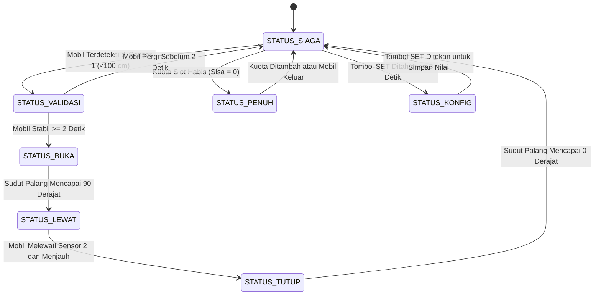

# Smart Parking Gate: Sistem Gerbang Parkir Otomatis Berbasis Arduino Uno

Proyek gerbang parkir otomatis berbasis mikrokontroler Arduino Uno (ATmega328P). Sistem dirancang mandiri (standalone firmware) tanpa ketergantungan koneksi IoT atau komputer eksternal. Seluruh pengendalian waktu menggunakan fungsi non-blocking (`millis()`) untuk memastikan pembacaan sensor, pergerakan palang, pembaruan tampilan LCD, dan alarm audio tetap responsif.

---

## Tautan Simulasi Proyek

Rangkaian dan kode firmware dapat diuji langsung melalui simulator Wokwi:

* **Simulasi Wokwi:** [https://wokwi.com/projects/478357778870884353](https://wokwi.com/projects/478357778870884353)

---

## Anggota Tim Pengembang

| No | Nama Lengkap | NIM |
| :-: | :--- | :-: |
| 1 | Fadhli Abdulhaq | 022400005 |
| 2 | Sofia Atifah | 022400026 |
| 3 | Muhammad Rifqi Januarjati Kurniawan | 022400034 |
| 4 | Hana Fitri Annisa | 022400021 |
| 5 | Hafizh Maulana Wijaya | 022400019 |
| 6 | Zhakya Aisyah Riswandhita | 022400017 |

---

## Aspek dan Bobot Penilaian

Evaluasi proyek terbagi dalam tiga kategori utama:

```text
[ ASPEK TEKNIS MURNI ] (Total: 35%)
  - Fungsi & Kinerja Sistem : 10%
  - Rancangan Arsitektur    : 15%
  - Algoritma & Pemrograman :  5%
  - Pengujian & Debugging   :  5%

[ PEMAHAMAN TEORI EMBEDDED ] (Total: 20%)
  - CPU, Program/Data Memory, GPIO, Periferal, Min. System : 20%

[ LUARAN PUBLIKASI & KOMUNIKASI ] (Total: 45%)
  - Poster Banner (80x120 cm)     : 15%
  - File Presentasi (8-10 slide)  : 15%
  - Laporan Proyek (5-8 halaman)  : 15%
```

---

## Gambaran Umum Proyek

### 1. Masalah Titik Buta Sensor Tunggal
Pada gerbang parkir yang hanya memiliki satu sensor di pintu masuk, palang berisiko turun saat kendaraan belum sepenuhnya lewat. Ketika bagian depan mobil sudah melewati jangkauan sensor masuk tetapi bagian tengah atau belakang masih berada di bawah palang, sensor membaca area tersebut kosong. Kondisi ini dapat menyebabkan palang membentur atap kendaraan.

### 2. Solusi Dua Sensor
Untuk mencegah benturan fisik, sistem menggunakan dua sensor ultrasonik HC-SR04:
* **Sensor 1 (Masuk):** Terpasang sebelum palang untuk mendeteksi kendaraan yang datang. Sistem menerapkan filter jeda 2 detik agar objek yang hanya melintas cepat (seperti pejalan kaki) tidak memicu pembukaan palang.
* **Sensor 2 (Keluar):** Terpasang setelah palang. Palang hanya akan diperintahkan turun jika kendaraan telah terdeteksi melewati Sensor 2 dan benar-benar keluar dari jangkauan palang.
* **Arsitektur Non-blocking:** Logika program menggunakan pencacah waktu `millis()` tanpa fungsi `delay()`, sehingga siklus loop tetap berjalan kontinu.

---

## Tata Letak Fisik Sistem

### 1. Tampak Atas Jalur Gerbang

```text
       ================================================================================
                                   AREA TROTOAR KIRI
       ================================================================================
            |                                 |                                 |
            v                                 v                                 v
       +-----------+                     +-----------+                     +-----------+
       | SENSOR 1  |                     | TIANG &   |                     | SENSOR 2  |
       | (Entry)   |                     | MOTOR     |                     | (Exit)    |
       | HC-SR04   |                     | SERVO     |                     | HC-SR04   |
       +-----+-----+                     +-----+-----+                     +-----+-----+
             | Gelombang 40 kHz                | [Palang Tutup 0°]               | Gelombang 40 kHz
             v Sudut Tembak 90°                v Melintang Lajur                 v Sudut Tembak 90°
       . . . . . . . . . . . . . . . . . +-----------+ . . . . . . . . . . . . . . . . .
                                         |  PALANG   |
                                         |  BARRIER  |
                                         +-----+-----+
       ----------------------------------------+----------------------------------------
                      ARAH GERAK KENDARAAN ->  | -> MENUJU AREA PARKIR
       ----------------------------------------+----------------------------------------
                                       | <- Lebar Lajur: 2.5 - 3.0 m -> |
            ^                                                                   ^
            | <------ Jarak: 1.5 - 2.0 m -----> | <----- Jarak: 1.5 - 2.0 m ----> |
            |                                   |                               |
       +----+------------------------+          |                        +------+------+
       |   TIANG DISPLAY & KONTROL   |          |                        |   PEMBATAS  |
       |  - LCD 16x2 I2C             |          |                        |    JALUR    |
       |  - LED Hijau & Merah        |          |                        |    KANAN    |
       |  - Buzzer Alarm             |          |                        +-------------+
       |  - Tombol Pengaturan        |          |
       +-----------------------------+          |
       ================================================================================
                                  AREA TROTOAR KANAN / POS JAGA
       ================================================================================
```

### 2. Tampak Depan Gerbang

```text
               +-------------------------------+
               |    SMART PARKING SYSTEM       |
               |   SLOT: 08/10 OPEN            |  <-- Display LCD 16x2 I2C
               +--------------+----------------+
                              |
                      ( O )  ( O )  <-- [LED Merah: STOP] / [LED Hijau: JALAN]
                        |      |
                        |      +------ Buzzer Peringatan
                        |
                +-------+-------+
                |               |
                |  KOTAK KONTROL|============================================== [Palang Gerbang]
                |  ARDUINO UNO  |                  (Posisi 0°: Menutup)
                |               |
         -------+---------------+-----------------------------------------------
         //////////////////////////////// ASPAL JALUR PARKIR ///////////////////////////
```

### 3. Parameter Geometris
* **Lebar Lajur:** 2.5 sampai 3.0 meter (standar satu mobil).
* **Jarak Sensor 1:** 1.5 sampai 2.0 meter sebelum tiang palang, memberikan jarak henti kendaraan.
* **Jarak Sensor 2:** 1.5 sampai 2.0 meter setelah tiang palang, memastikan ekor mobil telah bebas sebelum palang menutup.
* **Arah Sensor 90 Derajat:** Sensor diarahkan melintang tegak lurus ke bodi samping mobil agar pantulan gelombang ultrasonik tidak terganggu oleh kemiringan aerodinamis bumper.

---

## Fitur Utama

1. **Sistem Dua Sensor (Masuk dan Keluar):**
   Palang tidak akan turun sebelum kendaraan melintasi Sensor 2 dan benar-benar keluar dari jangkauan palang.
2. **Filter Waktu Deteksi (2 Detik):**
   Menghindari pembukaan palang akibat objek yang melintas sekilas. Kendaraan harus berhenti stabil minimal 2 detik di depan Sensor 1.
3. **Gerak Servo Bertahap:**
   Servo digerakkan secara bertahap (1 derajat setiap 15 milidetik) sehingga pergerakan palang halus dan tidak membebani gir motor.
4. **Penyimpanan Kuota di EEPROM:**
   Kapasitas maksimum slot parkir tersimpan di EEPROM internal Arduino. Nilai kuota tetap tersimpan meski catu daya terputus. Penulisan menggunakan `EEPROM.update()` untuk memperpanjang usia pakai memori.
5. **Mode Pengaturan dengan Pengaman:**
   Menu ubah slot hanya dapat dibuka jika tombol SET ditahan selama 3 detik pada saat gerbang dalam kondisi siaga (tertutup). Selama mode pengaturan, palang terkunci rapat.
6. **Antarmuka Pengguna (LCD, LED, Buzzer):**
   * LCD 16x2 I2C menampilkan sisa slot dan status operasi dengan pembaruan berkala tanpa flicker.
   * LED Merah menandakan kendaraan harus berhenti atau kuota penuh, sedangkan LED Hijau menandakan akses terbuka.
   * Buzzer memberikan nada konfirmasi saat kendaraan tervalidasi, nada peringatan saat palang turun, dan nada panjang saat kuota penuh.

---

## Komponen Perangkat Keras

| No | Komponen | Spesifikasi / Model | Fungsi |
| :-: | :--- | :--- | :--- |
| 1 | Arduino Uno R3 | ATmega328P, 16 MHz | Pengolah logika utama, pencacah millis, dan kontrol periferal. |
| 2 | Sensor Ultrasonik Masuk | HC-SR04 | Mendeteksi keberadaan kendaraan sebelum palang. |
| 3 | Sensor Ultrasonik Keluar | HC-SR04 | Mendeteksi keluarnya kendaraan setelah melewati palang. |
| 4 | Motor Servo | SG90 / MG996R | Menggerakkan palang gerbang antara posisi 0° dan 90°. |
| 5 | LCD 16x2 dengan Modul I2C | Driver PCF8574 (Alamat 0x27) | Menampilkan kapasitas slot dan pesan panduan. |
| 6 | LED Merah | 5mm + Resistor 220 Ohm | Indikator dilarang melintas atau kuota penuh. |
| 7 | LED Hijau | 5mm + Resistor 220 Ohm | Indikator akses terbuka (aman melintas). |
| 8 | Buzzer | Piezoelektrik | Memberikan peringatan suara sesuai kondisi sistem. |
| 9 | Tiga Tombol Tekan | Push Button (Active-LOW) | Pengaturan kuota slot (tombol UP, DOWN, SET). |
| 10 | Breadboard & Kabel | Kabel Jumper | Penghubung daya dan sinyal antar komponen. |

---

## Alokasi Pin I/O Arduino Uno

Pemanfaatan pin mikrokontroler diatur secara efisien tanpa memerlukan IC expander tambahan:

### 1. Diagram Pinout Arduino Uno

```text
                               +----------------------+
                               |     ARDUINO UNO      |
                               +----------------------+
                 [Serial TX] D0---|                      |--- A5 [SCL] --- LCD 16x2 I2C
                 [Serial RX] D1---|                      |--- A4 [SDA] --- LCD 16x2 I2C
              Tombol UP (D2) ---| D2                   |--- A3 (Cadangan)
               (Cadangan NC) ---| D3                   |--- A2 (Cadangan)
            Sensor 1 TRIG (D4) ---| D4                   |--- A1 (Cadangan)
            Sensor 1 ECHO (D5) ---| D5                   |--- A0 (Cadangan)
            Sensor 2 TRIG (D6) ---| D6                   |
            Sensor 2 ECHO (D7) ---| D7                   |--- VIN
            Tombol DOWN (D8) ---| D8                   |--- 5V  --- Jalur Daya Positif
             Motor SERVO (D9) ---| D9 (PWM)             |--- 3V3
            Tombol SET (D10) ---| D10                  |--- GND --- Ground Bersama
             LED Hijau (D11) ---| D11                  +--- RST
             LED Merah (D12) ---| D12
                Buzzer (D13) ---| D13
                               +----------------------+
```

### 2. Tabel Sambungan Pin

| Komponen | Pin Komponen | Pin Arduino | Nama Konstanta | Mode Pin | Keterangan |
| :--- | :--- | :-: | :--- | :-: | :--- |
| LCD 16x2 I2C | SDA, SCL, VCC, GND | A4, A5, 5V, GND | `ALAMAT_LCD` (`0x27`) | I2C | Komunikasi data tampilan via jalur I2C. |
| Sensor 1 (Masuk) | TRIG, ECHO, VCC, GND | D4, D5, 5V, GND | `PIN_TRIG_MASUK`, `PIN_ECHO_MASUK` | OUTPUT, INPUT | Deteksi awal mobil masuk. |
| Sensor 2 (Keluar) | TRIG, ECHO, VCC, GND | D6, D7, 5V, GND | `PIN_TRIG_KELUAR`, `PIN_ECHO_KELUAR` | OUTPUT, INPUT | Verifikasi mobil telah selesai lewat. |
| Motor Servo | PWM, VCC, GND | D9, 5V, GND | `PIN_SERVO` | OUTPUT (PWM) | Kontrol posisi palang (0° tutup, 90° buka). |
| Tombol UP | Terminal 1, 2 | D2, GND | `PIN_TOMBOL_UP` | INPUT_PULLUP | Menambah nilai kuota slot. |
| Tombol DOWN | Terminal 1, 2 | D8, GND | `PIN_TOMBOL_DOWN` | INPUT_PULLUP | Mengurangi nilai kuota slot. |
| Tombol SET | Terminal 1, 2 | D10, GND | `PIN_TOMBOL_SET` | INPUT_PULLUP | Masuk menu config (tahan 3s) dan simpan. |
| LED Hijau | Anoda, Katoda | D11, GND | `PIN_LED_HIJAU` | OUTPUT | Akses terbuka (resistor seri 220 Ohm). |
| LED Merah | Anoda, Katoda | D12, GND | `PIN_LED_MERAH` | OUTPUT | Stop / palang gerak / penuh (resistor 220 Ohm). |
| Buzzer | Positif, Negatif | D13, GND | `PIN_BUZZER` | OUTPUT | Umpan balik suara. |

---

## Arsitektur Sistem dan State Machine

Logika utama program dibagi ke dalam 7 kondisi pada mesin status (Finite State Machine):



### Tabel Status Indikator dan Aktuator

| Status Sistem | Sudut Palang | LED Merah | LED Hijau | Buzzer | Pesan Baris 1 & 2 LCD |
| :--- | :-: | :-: | :-: | :--- | :--- |
| `STATUS_SIAGA` | 0° | Hidup | Mati | Senyap | `SLOT: XX/YY OPEN`<br>`SILAKAN MENDEKAT` |
| `STATUS_VALIDASI` | 0° | Hidup | Mati | Senyap | `MENDETEKSI...   `<br>`MOHON TUNGGU 2S ` |
| `STATUS_BUKA` | 0° -> 90° | Kedip Cepat | Mati | Bip Cepat | `MEMBUKA GERBANG `<br>`HARAP BERHENTI  ` |
| `STATUS_LEWAT` | 90° | Mati | Hidup | Bip 2x | `SILAKAN MASUK   `<br>`HATI-HATI JALAN ` |
| `STATUS_TUTUP` | 90° -> 0° | Kedip Cepat | Mati | Bip Kontinu | `MENUTUP GERBANG `<br>`AWAS PALANG TURUN` |
| `STATUS_PENUH` | 0° | Kedip Lambat | Mati | Bip Panjang | `PARKIR PENUH!   `<br>`AKSES DITOLAK    ` |
| `STATUS_KONFIG` | 0° | Kedip Bersama | Kedip Bersama | Bip Tombol | `ATUR MAX SLOT   `<br>`KAPASITAS: < XX >` |

---

## Struktur Berkas Proyek

```text
smart-parking-gate/
├── README.md                           # Dokumentasi teknis proyek
├── config.h                            # Definisi pin, konstanta waktu, enum FSM, dan prototipe fungsi
├── sketch.ino                          # Program utama Arduino: setup() dan loop() FSM
├── module_sensor.h                     # Pembacaan ultrasonik HC-SR04 dan filter waktu
├── module_display.h                    # Kontrol LCD 16x2 I2C dan pola kedipan LED
├── module_audio.h                      # Pembangkit pola nada buzzer secara non-blocking
├── module_storage.h                    # Pembacaan tombol pengaturan dan operasi EEPROM
├── diagram.json                        # Definisi komponen dan koneksi kabel di Wokwi
├── wokwi-project.txt                   # Tautan repositori ke simulator Wokwi
└── manual_book_smart_parking_gate.md   # Dokumen spesifikasi teknis lengkap tim
```

---

## Skenario Pengujian Sistem

| ID | Skenario | Langkah Pengujian | Hasil yang Diharapkan |
| :-: | :--- | :--- | :--- |
| **TC-01** | Filter Objek Lewat | Dekatkan objek ke Sensor 1 selama kurang dari 2 detik lalu jauhkan kembali. | Palang tetap tertutup (0°), sistem kembali ke mode siaga. |
| **TC-02** | Validasi Masuk | Tahan objek pada Sensor 1 selama minimal 2 detik. | Nada konfirmasi berbunyi, palang membuka ke 90°, LED Hijau menyala. |
| **TC-03** | Proteksi Tabrakan | Saat palang terbuka, dekatkan objek ke Sensor 2 dan biarkan di sana. | Palang tetap bertahan di posisi 90°, tidak menutup selama sensor 2 terhalang. |
| **TC-04** | Penutupan Setelah Lewat | Setelah Sensor 2 mendeteksi objek, jauhkan kembali objek dari Sensor 2. | Palang turun perlahan ke 0°, buzzer peringatan berbunyi, slot terisi bertambah 1. |
| **TC-05** | Kondisi Kuota Penuh | Isi kuota hingga sisa slot bernilai 0, lalu beri pemicu di Sensor 1. | Palang tetap terkunci di 0°, LED Merah berkedip lambat, akses ditolak. |
| **TC-06** | Ketahanan Data EEPROM | Masuk menu config, ubah kuota ke 25 slot, simpan, lalu restart sistem. | Nilai kuota tetap bernilai 25 slot setelah sistem kembali menyala. |

---

## Jadwal Pengerjaan Proyek

```text
MINGGU 1: Baseline Architecture & Environment Setup
Periode: 21 - 28 Oktober 2026
Target Rapat Evaluasi: Kamis, 22 Oktober 2026 (Siang)

Agenda Pertemuan Kamis, 22 Okt:
  - Penjelasan arsitektur sistem ke seluruh anggota (logika 2 sensor dan FSM).
  - Pembagian repositori GitHub dan file proyek Wokwi master.
  - Code of Conduct: Tidak mengubah file di luar modul masing-masing.

Target Output per Anggota (Selesai sebelum Kamis, 29 Okt):
  - Lead: Repositori GitHub siap dengan branch main berisi kerangka file kosong dan config.h.
  - Anggota 6: Sirkuit lengkap selesai dirangkai di Wokwi (diagram.json) dengan pewarnaan kabel rapi. Tautan master dibagikan ke tim.
  - Anggota 2, 3, 4, 5: Mulai fork/duplicate sirkuit master dan menulis fungsi modul masing-masing di akun Wokwi lokal.

----------------------------------------------------------------------------------------

MINGGU 2: Modular Development & Standalone Testing
Periode: 29 Oktober - 4 November 2026
Target Rapat Evaluasi: Kamis, 29 Oktober 2026 (Siang)

Agenda Pertemuan Kamis, 29 Okt:
  - Review progres kode di masing-masing modul.
  - Pemeriksaan fungsi non-blocking millis() pada setiap modul.

Target Output per Anggota (Selesai sebelum Kamis, 5 Nov):
  - Anggota 2 (Sensor): Logika filter jarak dan debounce 2 detik lolos uji via Serial Monitor.
  - Anggota 3 (Display): Tampilan LCD dan pola blink LED berfungsi tanpa flicker.
  - Anggota 4 (Audio): Pola nada buzzer non-blocking siap dipanggil fungsi.
  - Anggota 5 (Storage): Pembacaan 3 tombol stabil dan operasi EEPROM.update() sukses menyimpan nilai kapasitas.
  - Setiap anggota melakukan Pull Request (PR) ke repositori GitHub.

----------------------------------------------------------------------------------------

MINGGU 3: Full System Integration & Code Freeze
Periode: 5 - 11 November 2026
Target Rapat Evaluasi: Kamis, 5 November 2026 (Siang)

Agenda Pertemuan Kamis, 5 Nov:
  - Integrasi Masal: Lead menggabungkan seluruh modul .h ke sketch.ino master di Wokwi.
  - Demonstrasi langsung simulasi gerbang parkir berjalan utuh di hadapan seluruh anggota tim.

Target Output (Selesai sebelum Kamis, 12 Nov):
  - CODE FREEZE (Jumat, 6 Nov): Penambahan fitur dan pengubahan logika program dihentikan.
  - Anggota 6 & Lead: Menjalankan matriks pengujian skenario normal dan edge cases untuk dokumentasi laporan.
  - Peralihan Fokus ke Luaran Proyek: Pembagian penulisan laporan dan materi visual.

----------------------------------------------------------------------------------------

MINGGU 4: Paralel Deliverables Drafting & Simulasi Ujian
Periode: 12 - 18 November 2026
Target Rapat Evaluasi: Kamis, 12 November 2026 (Siang)

Agenda Pertemuan Kamis, 12 Nov:
  - Evaluasi draf Laporan (Bab I - VI), draf Poster 80x120 cm, dan draf Slide Presentasi.
  - Simulasi Ujian Internal (Dry Run 1): Pengujian pemahaman konsep embedded untuk setiap anggota. Lead bertindak sebagai penguji.

Target Output (Selesai sebelum Kamis, 19 Nov):
  - Laporan tertulis selesai (maksimal 8 halaman).
  - Poster selesai di-render dengan resolusi cetak (300 DPI).
  - Slide presentasi 8-10 halaman selesai dengan alokasi bicara per anggota.
```

---

## Panduan Penggunaan dan Pengujian

### 1. Menjalankan di Simulator Wokwi
1. Buka tautan: [Simulasi Wokwi Smart Parking Gate](https://wokwi.com/projects/478357778870884353).
2. Klik tombol **Start Simulation** (ikon Play segitiga hijau).
3. Simulasi kedatangan kendaraan:
   * Klik modul **Sensor 1 (HC-SR04 Masuk)**.
   * Atur jarak di bawah 100 cm (misalnya 40 cm) dan tahan selama minimal 2 detik.
   * Amati LCD memperbarui status, palang terbuka perlahan ke 90°, LED Hijau menyala, dan nada konfirmasi berbunyi.
4. Simulasi kendaraan lewat:
   * Klik modul **Sensor 2 (HC-SR04 Keluar)** dan geser slider jarak ke bawah 100 cm.
   * Geser kembali ke atas 100 cm untuk menyimulasikan mobil telah menjauh.
   * Palang akan tertutup kembali secara bertahap dan kuota terisi bertambah 1.

### 2. Mengunggah ke Hardware Fisik
1. Hubungkan pin komponen ke board Arduino Uno sesuai tabel sambungan pin.
2. Sambungkan board ke komputer melalui kabel USB.
3. Buka file `sketch.ino` di Arduino IDE.
4. Pastikan library **LiquidCrystal_I2C** dan **Servo** telah terpasang.
5. Pilih board **Arduino Uno** dan port COM yang terdeteksi.
6. Tekan tombol **Upload** dan tunggu proses kompilasi hingga selesai.
